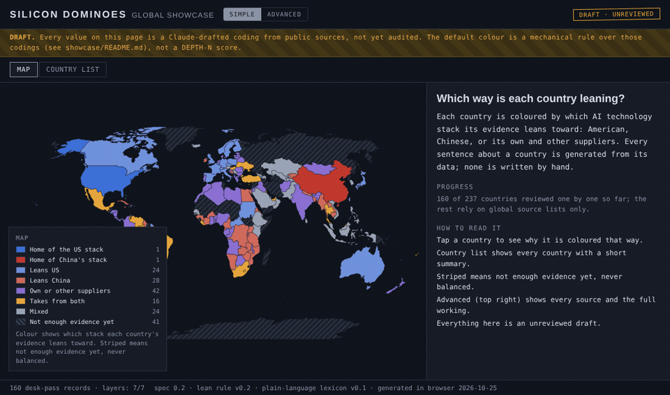

# Silicon Dominoes — global showcase

**Live:** <https://bjharbison.github.io/silicon-dominoes/showcase/>



A static, global first pass at the Silicon Dominoes map: every country, every layer that
can be filled from global source lists, plus a country-by-country desk pass that fills the
gaps ten countries a day. It exists to show what the finished dashboard will look like with
the whole world on it.

> **Every value here is a Claude-drafted coding from public sources.** Records are marked
> `unreviewed` until an audit pass checks them, and `audited` after a Claude audit that Brian
> has not yet reviewed. Nothing here is a DEPTH-N score, and nothing here is ingested by the
> pipeline.

## Where DEPTH-N fits

DEPTH-N is the project's measurement framework (`project-knowledge/01-methodology-depth-n.md`
on `main`). It scores each of the seven stack layers — Power, Facilities, Silicon, Networks,
Cloud, Models, Applications — on five dimensions: **D**ependence (whose kit is installed),
**E**xit cost (what leaving would cost), **P**rovenance & control (who can watch and who can
switch it off, kept separate), **T**rajectory (which way new commitments point, by instrument
tier) and **H**eadroom (how much the country can absorb). The **N** is the network: scores are
derived from dyadic exposure edges, not entered per country.

The showcase borrows only the smallest pieces of that — the seven layers, the instrument-tier
weights and the Goodhart cap on announcements — to colour a map from draft findings. It has
no D, E, P or H values and no exposure edges, which is why nothing here is a DEPTH-N score.

## What you see

| View | What it shows |
|---|---|
| **Simple → Map** | One colour per country: which stack its evidence leans toward. Tap a country for a plain-language summary, an evidence-share bar, and the items that count. |
| **Simple → Country list** | Every country, searchable, with its lean and a one-line summary. |
| **Advanced → Stack lean (derived)** | The same colour, with the arithmetic exposed: every finding's weight, pole, tier and cap, down to the number. |
| **Advanced → Blocs** | Pax Silica / WAICO membership (Tier-1 instrument: what governments signed). |
| **Advanced → US cloud** | Generally available AWS / Azure / Google Cloud regions in-country. |
| **Advanced → PRC cloud** | Alibaba / Huawei / Tencent Cloud regions outside mainland China. |
| **Advanced → PRC-model limits** | National government restrictions on DeepSeek and other PRC models. |
| **Advanced → US chip export** | US licence posture for advanced AI chips — a US decision *about* the country, shown but never counted in the lean. |
| **Advanced → Desk pass** | Which countries have been coded one by one, and how many findings each has. |

The **Simple / Advanced** switch is top right and is remembered per browser. The footer
stamps the record count, spec version, lean-rule version and lexicon version, so a screenshot
can always be traced to the rules that produced it.

Hatched means *insufficient data*. It is never drawn as a neutral midpoint, because "we
don't know" and "balanced" are different facts.

## Progress

Five global layers cover every country. The desk pass adds a dated, sourced record per
country at ten a day, in this order: the nine pilot countries, bloc members, high-salience
others, the remaining states alphabetically, dependent territories last. Twelve uninhabited
or disputed territories are excluded (listed in `queue.json`). The map's side panel shows the
live count; `RUNLOG.md` has one entry per run.

A weekly audit (Sundays) re-opens cited sources for a sample of records, applies corrections
under a restricted guard, and writes a dated report (`AUDIT-YYYY-MM-DD.md`). Audited records
are marked on the map. Rule changes the audit proposes are decisions for Brian, never applied
by the run.

## Run it locally

The page fetches its JSON, so `file://` will not work. From the repo root:

```bash
python3 -m http.server 8765
# then open http://localhost:8765/showcase/
```

`showcase-update.ps1` (in Project knowledge, not in this repo) does the same from a separate
checkout on Windows.

## Relationship to the rest of the repo

- Lives entirely in `showcase/` on the `showcase` branch. It never edits `map.html`, the
  schemas, the collector or anything else. GitHub Pages builds `main` plus this folder from
  the `showcase` branch every six hours, so nothing here needs to be merged to `main` to be
  published.
- It deliberately departs from `CLAUDE.md` §6 ("agents do not code events"): Brian chose on
  2026-09-23 and 2026-10-19 to have Claude draft codings for a showcase, shown as unreviewed.
  The departure is contained: these are draft *findings*, not DEPTH-N scores; there are no
  exposure values, postures or D/E figures; the map's colour is a labelled mechanical rule.
- The pipeline's guarantees (corroboration enforced in review, immutable events, Brier
  ledger) do not apply here. If a showcase finding is worth keeping, it goes through the
  review queue like any other lead.

## Files

| Path | What | Who writes it |
|---|---|---|
| `index.html` | the single-file dashboard (d3, no build step) | build session |
| `SPEC.md` | coding rules every desk-pass run follows (v0.2) | Brian (Claude drafts) |
| `AUDIT_PROCEDURE.md` | what the weekly audit may check and change | Brian (Claude drafts) |
| `AUDIT-YYYY-MM-DD.md` | one report per audit | weekly audit (add-only) |
| `data/diplomatic_alignment.json` | WAICO / Pax Silica membership | build session |
| `data/us_cloud_regions.json` | AWS / Azure / Google Cloud regions | build session |
| `data/prc_cloud_regions.json` | Alibaba / Huawei / Tencent Cloud regions | build session |
| `data/prc_model_restrictions.json` | government restrictions on PRC models | build session |
| `data/us_chip_export_posture.json` | US advanced-chip export licence posture | build session |
| `data/country_names.json` | display names | build session |
| `countries/<ISO3>.json` | desk-pass record per country | daily runs (add-only); weekly audit (corrections) |
| `queue.json` | which countries are pending / done / excluded | daily runs |
| `RUNLOG.md` | one entry per run | daily runs and audits (append) |
| `tools/guard.py`, `tools/safe_push.sh` | push guard (see below) | build session only |
| `tools/check_country.py` | record validator against `SPEC.md` §3–4 | build session only |
| `docs/showcase.gif` | the tour above, recorded from the live page | build session |

## Safety model

Unattended runs can only add. Every automated push goes through
`tools/safe_push.sh <mode>`, which runs `tools/guard.py --mode <mode>` first and stops with
nothing pushed if the guard refuses. The push itself is a plain fast-forward of `showcase`
only — no `--force`, no tags, no deletes.

| Mode | Who | May change |
|---|---|---|
| `daily` | the desk-pass run | new `countries/<ISO3>.json` files (≤ 15, each `unreviewed`), `queue.json`, `RUNLOG.md` |
| `audit` | the weekly audit | one new `AUDIT-YYYY-MM-DD.md`, `RUNLOG.md`, corrections to existing records that keep every finding id and add one `corrections` entry |
| `build` | a session Brian is watching | anything under `showcase/` |

In every mode the guard refuses a push that would delete or rename any file, touch a path
outside `showcase/`, or rewrite published history. `main` is frozen at
`backup/main-2026-10-19` as an extra copy. A GitHub ruleset blocking deletions and force
pushes on all branches is the backstop that does not depend on any of this code.

## Simple and Advanced views

The page opens in **Simple**. Simple shows the derived-lean map with plain legend labels, a
country list, and a plain summary per country. Advanced is the full layer-by-layer page with
every source.

Every Simple sentence about a country is assembled mechanically from the `LEX` object in
`index.html` plus the data: the lean cell, the two strongest pieces of evidence (by weight),
whether the evidence is mostly announcements (Tier 1–2) or contracts and built projects
(Tier 3–5), and whether the desk pass has reached the country. There is no hand-written text
about any country. A wording change edits `LEX` and bumps `LEX.version`, which is stamped in
the footer. Simple mode never changes the lean rule below; it only words its output.

## Derived lean (the default map colour)

Display-only, recomputed in the browser from the files above, never stored.

1. Each piece of evidence adds weight to the pole of its **controller**:
   instrument tier weights T1 0.15 · T2 0.35 · T3 0.70 · T4 0.85 · T5 1.00.
   - desk-pass finding: its tier weight to its `pole` (`domestic` and `third` both count as
     *sovereign/third*); halved if `confidence` is low; **negative** if `reversal: true`.
     Rule v0.2 (after `AUDIT-2026-10-22.md`): only reversals with `reversal_reason`
     `geopolitical` or `sanctions` count (permit pauses, business decisions and law
     enforcement do not); `municipal` findings count half; non-reversal findings dated
     before 2020 count half unless `still_current: true`, and zero if `still_current: false`.
   - US cloud region live (any of AWS/Azure/GCP): US +1.00; announced only: US +0.35.
   - PRC cloud region live (any of Alibaba/Huawei/Tencent): PRC +1.00; announced only: PRC +0.35.
   - Bloc membership: +0.15 to that bloc's pole.
   - Restriction on PRC models in force: national block PRC −0.70; government devices or a
     sector PRC −0.35.
   - US chip-export posture is **not** counted: it is a US decision about the country, not the
     country's own choice. It has its own layer.
2. Goodhart cap: positive Tier-1/2 contributions to any one pole are capped at 0.30 in total.
3. Pole totals below zero are shown as zero.
4. Cell: total < 0.70 → **insufficient data** (hatched, never neutral). Otherwise, if US and
   PRC each hold ≥ 30% of the total → **contested**; else if one pole holds ≥ 50% →
   **leans US / PRC / sovereign-third**; else **mixed**.
5. The United States and China are shown as the two poles, not scored: hosting the
   other side's cloud regions would otherwise make the US look contested.

Until a country's desk pass lands, its lean rests only on the global layers, which
over-weight hyperscaler presence and under-count sovereign and PRC network stacks. The
"Desk pass" layer shows which countries have been coded.

## Re-recording the GIF

`docs/showcase.gif` is 36 stills of the page at 1100×650, assembled at 1.25 frames per
second. To refresh it after a visual change: serve the repo locally, screenshot the Simple
map, a country summary, the Advanced mode and each layer button in turn, then
`ffmpeg -framerate 1.25 -i f%03d.png -vf "scale=960:-1,split[a][b];[a]palettegen[p];[b][p]paletteuse" -loop 0 docs/showcase.gif`.
